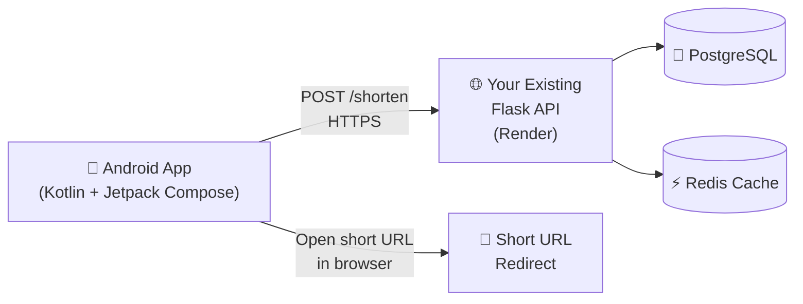
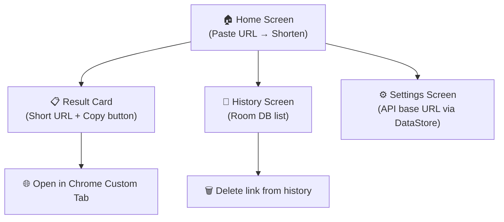

# 🤖 Android App Tech Stack — URL Shortener

> [!NOTE]
> Your current project is a **Flask + PostgreSQL + Redis** backend with a plain HTML/JS frontend served via Nginx in Docker. The backend API is already production-ready and deployed on Render. The Android app would simply be a native client that talks to your existing `/shorten` and `/<short_code>` endpoints.

---

## Architecture Overview



---

## Recommended Tech Stack

### 🏗️ Language & UI Framework
| Layer | Choice | Why |
|-------|--------|-----|
| Language | **Kotlin** | Official Android language, concise, null-safe |
| UI | **Jetpack Compose** | Modern declarative UI, Google's current standard |
| Min SDK | **API 26 (Android 8.0)** | Covers ~95%+ of active devices |

### 🌐 Networking (talking to your Flask API)
| Library | Purpose |
|---------|---------|
| **Retrofit 2** | Type-safe HTTP client; maps `/shorten` POST directly to a Kotlin data class |
| **OkHttp 4** | Underlying HTTP engine + logging interceptor for debugging |
| **Kotlin Serialization / Gson** | JSON deserialization of API responses |

Your API endpoints map cleanly:
```kotlin
interface UrlShortenerApi {
    @POST("shorten")
    suspend fun shorten(@Body body: ShortenRequest): ShortenResponse

    // Redirect handled by the browser / custom tabs
}
```

### 🧠 Architecture Pattern
**MVVM + Clean Architecture** (Google's recommended pattern)

```
app/
├── ui/           ← Composables (screens, components)
├── viewmodel/    ← State holders, exposes StateFlow
├── repository/   ← Single source of truth, calls API & Room
├── data/
│   ├── remote/   ← Retrofit service, DTOs
│   └── local/    ← Room database
└── di/           ← Hilt dependency injection modules
```

### 🗄️ Local Storage (link history)
| Library | Purpose |
|---------|---------|
| **Room** | Local SQLite database; replaces `localStorage` from your web frontend |
| **DataStore (Preferences)** | Stores the base API URL setting (replaces `localStorage.getItem(BASE_KEY)`) |

### 💉 Dependency Injection
- **Hilt** — Google's official DI library for Android, reduces boilerplate, integrates with `ViewModel`

### ⚡ Async & Concurrency
- **Kotlin Coroutines + Flow** — Replaces JS Promises/async-await; `StateFlow` drives UI state in Compose

### 🔗 Opening Short URLs
- **Chrome Custom Tabs** — Opens short URLs in an in-app browser tab (much better UX than system WebView)

### 📋 Clipboard
- Android's built-in `ClipboardManager` — directly replaces `navigator.clipboard.writeText()`

### 🔔 Optional but Recommended
| Feature | Library |
|---------|---------|
| Error/crash reporting | **Firebase Crashlytics** |
| Analytics | **Firebase Analytics** |
| Rate limit UI feedback | `Snackbar` / `Toast` in Compose |

---

## Project Setup (Gradle)

```kotlin
// build.gradle.kts (app)
dependencies {
    // Compose BOM
    implementation(platform("androidx.compose:compose-bom:2024.06.00"))
    implementation("androidx.compose.ui:ui")
    implementation("androidx.compose.material3:material3")
    implementation("androidx.activity:activity-compose:1.9.0")

    // Networking
    implementation("com.squareup.retrofit2:retrofit:2.11.0")
    implementation("com.squareup.retrofit2:converter-gson:2.11.0")
    implementation("com.squareup.okhttp3:logging-interceptor:4.12.0")

    // Architecture
    implementation("androidx.lifecycle:lifecycle-viewmodel-compose:2.8.3")
    implementation("androidx.lifecycle:lifecycle-runtime-ktx:2.8.3")

    // Local DB & Prefs
    implementation("androidx.room:room-runtime:2.6.1")
    implementation("androidx.room:room-ktx:2.6.1")
    ksp("androidx.room:room-compiler:2.6.1")
    implementation("androidx.datastore:datastore-preferences:1.1.1")

    // DI
    implementation("com.google.dagger:hilt-android:2.51.1")
    ksp("com.google.dagger:hilt-android-compiler:2.51.1")
    implementation("androidx.hilt:hilt-navigation-compose:1.2.0")

    // Browser
    implementation("androidx.browser:browser:1.8.0")

    // Coroutines
    implementation("org.jetbrains.kotlinx:kotlinx-coroutines-android:1.8.1")
}
```

---

## Backend Changes Required

> [!IMPORTANT]
> Your existing Flask backend needs **zero changes** for the Android app to work. The API is already:
> - ✅ CORS-enabled (`flask-cors`)
> - ✅ JSON in/out
> - ✅ Rate-limited (10 req/min per IP)
> - ✅ HTTPS on Render
>
> The Android app simply replaces the browser as the client.

> [!TIP]
> Consider adding **JWT authentication** or **API key headers** in a future iteration to tie short links to user accounts.

---

## Screen Map



---

## Production Readiness Checklist

- [ ] **ProGuard / R8** minification enabled for release builds
- [ ] **Network Security Config** — pin your Render domain (HTTPS only)
- [ ] **Offline state** — show cached links from Room when network is unavailable
- [ ] **Rate limit handling** — show user-friendly message on HTTP 429
- [ ] **Deep link handling** — register `yourdomain.com` as an Android App Link so short URLs open in the app
- [ ] **Play Store** — sign APK with upload keystore, fill out store listing
- [ ] **GitHub Actions CI** — automate build + lint on every push

---

## Summary

| What you have | What you're adding |
|---|---|
| Flask REST API (Python) | Kotlin + Jetpack Compose Android app |
| PostgreSQL | Room (local mirror of history) |
| Redis cache | DataStore (preferences) |
| `localStorage` (web) | Room DB (Android) |
| `fetch()` (JS) | Retrofit + OkHttp (Android) |
| Plain HTML/CSS UI | Material 3 Compose UI |
